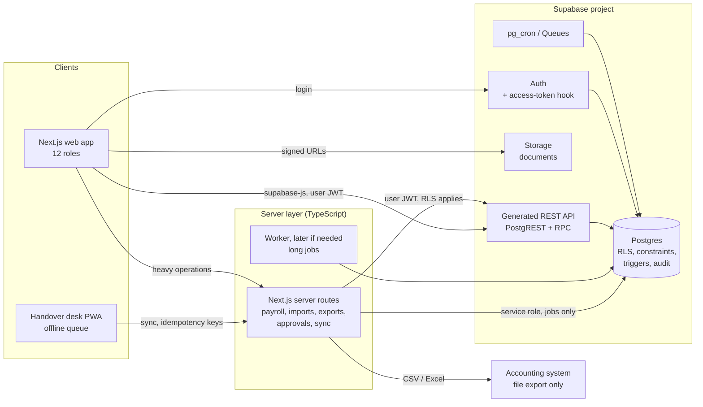

# ITHC Fleet Operations Platform: Backend Architecture

Status: **draft for review**. Nothing here is built yet. Table and function names are proposals. Items marked **OPEN** need a decision before the related schema is written.

Sources: `Docs/ITHC_FLEET_PLATFORM_SPEC.pdf` (v1.3, "spec"), `Docs/ITHC-Fleet-Personal Understanding.docx` ("roles doc"), and the frontend shell in `frontend/src/config`, which lists every page's requirements.

---

## 1. Goals and constraints

The backend stores and enforces the rules of a multi-company fleet and workforce business. The frontend shell already defines 12 roles and about 100 pages. This document defines what sits behind them.

| Constraint (spec ref) | What it forces |
|---|---|
| Money in KD, 3 decimals (fils) | `numeric(14,3)` in the database, integer fils in code, one rounding rule |
| Multi-company scoping (§4, §5.1) | Every business row carries a company; access is checked on every query |
| Access resolves independently on employing company, contract-owning company and client (§4) | Scope is a set of memberships, not a single `company_id` on the user |
| Date-ranged assignments, inclusive end dates (§3.5) | Postgres range types with exclusion constraints |
| Retroactive corrections must not alter closed payroll (§3.5) | Period locking, corrections posted as adjustments |
| Contract versioning, config-driven contract types (§5.4) | Versioned rows, type rules in configuration tables |
| Optimistic locking (§8.2) | `version` column on mutable records |
| Audit log on changes (§5.5) | Append-only audit table written in the same transaction |
| Document control is "storage plus dates" (§5.3a, §7.1a) | Document records plus object storage; no HR suite |
| Offline handover desk, 60-second target (§6.2) | PWA queue plus an idempotent sync endpoint |
| Accounting export boundary (§7.11) | Export files only; no general ledger |
| Excluded: WPS, PIFSS, indemnity, GL (§7.1a) | Not modelled |
| Arabic/RTL (phase unconfirmed) | Store text as UTF-8; no layout concerns in the backend |

Expected scale is small: dozens to a few hundred users, thousands of workers, vehicles and assignments, and a few concurrent users plus handover desks at shift change. One Postgres instance is enough.

---

## 2. System context



Two rules shape everything else:

1. **The database enforces the rules.** Precision, overlap, scoping and audit live in Postgres so no code path can bypass them.
2. **The service-role key never reaches a browser.** It is used only by background jobs on the server.

---

## 3. Components and responsibilities

| Component | Owns | Does not own |
|---|---|---|
| **Next.js frontend** (`frontend/`) | Screens, forms, client-side validation, company selector state | Authorization decisions; the server and database decide |
| **Supabase Auth** | Identities, sessions, password reset, token issue | Roles and scopes (stored in our tables, copied into token claims) |
| **Generated REST API** | CRUD on tables and views, RPC to Postgres functions | Multi-step business workflows beyond a single transaction |
| **Postgres** | Data, constraints, RLS, audit triggers, derived views, atomic functions | Long-running or file-heavy processing |
| **Storage** | Document files, import files, export files | Document metadata (kept in tables) |
| **Server layer** | Payroll runs, imports, exports, approvals, offline sync, report assembly | Direct data ownership; it calls the same database |
| **Scheduler** | Expiry derivation checks, reminders, period jobs | Anything that needs a human decision |

### Where each kind of request goes

| Work | Path |
|---|---|
| Lists, filters, simple create and edit, lookups | `supabase-js` → generated REST API, under RLS |
| Atomic multi-row change (for example, create an assignment and its audit entry) | Postgres function called as RPC |
| Payroll run, import, accounting export, contract approval, report assembly | Server route, forwarding the user's JWT |
| Offline handover sync | Server route with idempotency keys |
| Scheduled checks | `pg_cron` or a queue consumer |

---

## 4. Identity, access and scoping

### 4.1 Model

The frontend defines 12 roles: `ceo`, `admin`, `operations`, `finance`, `payroll`, `fleet`, `hr`, `client`, `housing`, `supervisor`, `handover`, `worker`.

| Table (proposed) | Purpose |
|---|---|
| `groups` | Top-level holding entity |
| `companies` | Legal operating entities (§5.1) |
| `profiles` | One row per auth user; links to a `workers` row (internal staff are Workers with internal roles, §5.2) |
| `roles` | The 12 roles, editable without a deploy |
| `modules` | Named areas of the system (workers, contracts, payroll, and so on) |
| `permissions` | role × module × action (`view`, `edit`, `approve`) |
| `user_roles` | User, role, and the companies it applies to |
| `user_scopes` | Extra scope: client, site, or handover desk for roles that need it |

### 4.2 How a request is authorized

1. The login produces a token. An **access-token hook** adds the user's role and a compact scope summary to `app_metadata` claims.
2. RLS policies call small **helper functions** (in a non-exposed `private` schema) that answer: can this user view or edit this module, for this company, client, site or desk?
3. Policies use the result. Server routes check the same helpers before heavy operations, so there is one definition of "allowed".

Security rules carried from Supabase guidance:

- Authorization data lives in `app_metadata`, never `user_metadata` (user-editable).
- JWT claims go stale until refresh, so sensitive operations (role change, deactivation) also check the database, not just the token.
- Helper functions are `SECURITY INVOKER` unless there is a documented reason, and any `SECURITY DEFINER` function lives in `private` with an explicit `auth.uid()` check.
- Views use `security_invoker = true`.
- UPDATE policies have both `USING` and `WITH CHECK`.

### 4.3 Scope per role

| Role | Scope |
|---|---|
| Group CEO | All companies, read-only everywhere (monitoring pages plus read-only copies of every module); company selector; approves contracts below 2.0× break-even |
| Company Admin | All companies with a selector (one, or combined); adds clients, manages users, roles and permissions; views workers, vehicles, assignments and audit logs; owns the compliance watchlist view |
| Operations Manager | Orders, assignments, schedules, stores, imports, reports, performance |
| Finance / Commercial Manager | Contracts, signed opportunities, revenue, cash, reconciliation, costs, contract documents |
| Payroll Manager | Payroll, advances, pay parameters and configuration |
| Fleet Manager | Vehicles, locations, inspections, damage, jobs, fuel, transport, vehicle documents (includes the merged service team) |
| HR / Workforce Manager | Workers, onboarding and offboarding, worker documents, worker watchlist; enters pay parameters at onboarding |
| Client Manager | Placements, pipeline, seat fill, bench, contact log, renewals |
| Housing Manager | Properties, occupancy, leases |
| Site Supervisor (including trusted client contacts) | Their own site only |
| Handover Desk Staff | Vehicles homed at their own desk only (§6.2) |
| Worker | Own shift, vehicle and acknowledgements; no Home page |

**OPEN:** Company Admin may upload or correct documents, or the watchlist stays strictly read-only for them.

### 4.4 Frontend company selector

The selector maps to a filter on a `company_ids` set. RLS still decides what the user may see, so the selector cannot widen access. "All companies (combined)" means the user's full allowed set.

---

## 5. Data model by domain

All business tables have: `id` (uuid), `company_id`, `created_at`, `created_by`, `updated_at`, `updated_by`, `version`. Exceptions are noted.

### 5.1 Organisation and reference
`groups`, `companies`, `clients` (with legal entity name for invoicing), `locations`, `stores`, `zones`.

**OPEN:** whether Max Dash and Swift Link are operating companies (spec) or external lessors (roles doc). The answer decides whether they are rows in `companies`, in a `lessors` table, or both.

### 5.2 Workforce
`workers` (type, status, employing company), `worker_roles`, `pay_parameters` (history, date-ranged), `onboarding_records`, `offboarding_records`.

Rule: HR enters initial pay parameters at onboarding; afterwards only Payroll edits them. Enforced by policy, not by the UI.

### 5.3 Vehicles
`vehicles`, `vehicle_types`, `vehicle_ownership` (date-ranged), `vehicle_documents`, `damage_reports`, `service_jobs`, `fuel_records`, `transport_requests`, `lessors` (from the roles doc; **OPEN**).

**OPEN:** mapping of in-house / leased (roles doc) to rented / cash / financed (spec).

### 5.4 Assignments
`driver_client_assignments`, `driver_vehicle_assignments`, `labour_placements`, `housing_occupancies`.

Every assignment table has a date range (`daterange`, inclusive end handled consistently) and an exclusion constraint so one resource cannot be double-booked in overlapping periods. This needs the `btree_gist` extension.

### 5.5 Contracts and commercial
`contract_types` (config-driven rules), `contracts`, `contract_versions`, `contract_rates`, `contract_documents`, `opportunities`, `opportunity_approvals`.

Rules: a signed opportunity hands off from Client Manager to Finance; a contract below 2.0× break-even needs Group CEO approval.

### 5.6 Money
`orders`, `order_lines`, `revenue_entries`, `cash_entries`, `reconciliations`, `costs`, `cost_categories`, `advances`, `payroll_periods`, `payroll_runs`, `payroll_lines`, `payslips`.

### 5.7 Documents and compliance
`documents` (generic: owner type, owner id, type, issue date, expiry date, issuing authority, version, file path), `document_types` (with alert tiers).

Compliance is a **derived view** over `documents` for workers, vehicles, contracts and leases, not a stored table (spec §5.3a). Tiers are configurable (reference: civil ID and licence 30 days; passport, visa, health card 60 days). A renewal supersedes the prior version and does not delete it.

### 5.8 Operations
`handovers`, `inspections`, `inspection_items`, `incidents`, `offline_sync_log` (idempotency keys), `import_batches`, `import_rows`, `performance_snapshots`.

### 5.9 Platform
`audit_log` (append-only), `contact_log`, `notifications` (**P2**, recorded not built), `export_jobs`, `job_runs`.

---

## 6. Cross-cutting conventions

| Concern | Convention |
|---|---|
| **Schemas** | `public` (exposed, RLS on every table), `private` (helper functions, not exposed), `audit` |
| **Money** | `numeric(14,3)`; code works in integer fils; one documented rounding rule; no floats anywhere |
| **Dates** | Date-ranged rows use `daterange` with inclusive end semantics defined once in a helper |
| **IDs** | uuid primary keys |
| **Time** | `timestamptz` in UTC; display conversion in the frontend |
| **Audit** | One trigger function attached to every business table; writes who, what, when, old and new values, and reason where supplied; append-only; same transaction as the change |
| **Optimistic locking** | `version` increments on update; an update with a stale version affects zero rows and returns a conflict |
| **Deletes** | Soft delete (`deleted_at`) for business records; hard delete only for transient data |
| **Naming** | snake_case; plural table names; `*_id` foreign keys |
| **Validation** | Constraints and checks in the database first; UI validation is a convenience |
| **Errors** | Stable error codes from RPC and server routes; the frontend maps codes to messages |

---

## 7. Domain logic and where it lives

| Domain | Rule | Placement |
|---|---|---|
| Assignments | No overlap; inclusive end dates | Exclusion constraints |
| Assignments | Retroactive change vs closed payroll | RPC checks period status; posts an adjustment instead of editing |
| Contracts | Versioning, rate lookup by date | Tables plus RPC |
| Contracts | Break-even and 2.0× approval gate | Postgres function for the calculation; server route for the approval flow |
| Payroll | Calculation, advances recovery, period close | Server TypeScript, with golden-file tests |
| Payroll | Period locking | Database status plus policy that blocks edits to locked periods |
| Compliance | Expiry tiers | SQL view reading `document_types` |
| Imports | Parse, validate, stage, apply, error report | Server route; staged in `import_batches` and `import_rows` |
| Reports and rankings | Aggregations | SQL views and functions; server route for exports |
| Accounting export | CSV / Excel generation | Server route writing to Storage, logged in `export_jobs` |

---

## 8. Documents and storage

- Buckets: `worker-documents`, `vehicle-documents`, `contract-documents`, `lease-documents`, `imports`, `exports`. All private.
- Access by signed URL; Storage policies mirror table policies.
- Storage upsert needs INSERT, SELECT and UPDATE policies together.
- File path convention: `{company_id}/{owner_type}/{owner_id}/{document_id}/{version}`.
- PDF and image types only for documents; size limit set per bucket.
- Metadata and dates live in `documents`; the file is the only thing in Storage.

---

## 9. Background jobs

| Job | Trigger | Notes |
|---|---|---|
| Expiry reminders | Daily | Reads the derived compliance view; notification centre is P2, so output is initially a list or email |
| Import processing | On upload | Chunked; progress in `import_batches` |
| Payroll run | User action | Runs in the server layer; idempotent per period |
| Export generation | User action | Result file in Storage |
| Snapshots (performance, rankings) | Nightly | Optional; only if live queries get slow |

Failures write to `job_runs` and surface in monitoring. Jobs are idempotent so a retry is safe.

---

## 10. Offline handover desk

Target: complete a handover in about 60 seconds, including with no connection (§6.2).

1. The PWA stores handover and inspection entries in IndexedDB with a client-generated UUID as the idempotency key.
2. When online, it posts the queue to the sync route in order.
3. The server records each key in `offline_sync_log`; a repeated key returns the earlier result and writes nothing.
4. Conflicts (for example, the vehicle was reassigned while offline) use the `version` check; the entry is accepted with a flag, or sent to a review list. **OPEN:** which of the two.
5. Desk staff see only vehicles homed at their desk, enforced by `user_scopes` and RLS, including in cached data.

---

## 11. Security

- RLS on every table in an exposed schema; no table without a deliberate policy.
- Publishable key only in the frontend; service-role key only in server environments.
- Pinned dependency versions and committed lockfiles.
- Deactivating a user revokes sessions first, because deleting a user does not invalidate tokens already issued.
- Short access-token lifetime; sensitive actions re-check the database.
- Personal data (civil IDs, passports) is limited to roles that need it by policy and by column choice in views.
- Run Supabase advisors before every migration is committed.
- **OPEN:** data residency and retention rules for civil IDs and passports; confirm the project region against them before creating production.

---

## 12. Environments, migrations and delivery

| Environment | Purpose |
|---|---|
| Local | Supabase CLI stack in Docker; reset and reseed freely |
| Staging | Hosted project; mirrors production; used for acceptance testing |
| Production | Hosted project on a plan with backups and no pausing |

- All schema changes are migrations in `backend/supabase/migrations`, created with `supabase migration new`.
- Iterate with direct SQL locally, then generate one clean migration when ready.
- `backend/supabase/seed.sql` and fixtures create the 12 roles, permissions, and sample companies and users.
- CI runs: migrate from scratch, policy tests, constraint tests, payroll golden files, advisors, type generation check.
- Generated TypeScript types are committed and consumed by `frontend/`.

Proposed layout:

```
backend/
  ARCHITECTURE.md
  supabase/
    config.toml
    migrations/
    seed.sql
    tests/            # policy, constraint and payroll tests
  server/             # shared server logic (payroll, imports, exports)
```

---

## 13. Testing strategy

| Layer | Tests |
|---|---|
| Policies | For each of the 12 roles: what they can read and change, and what they cannot, including across companies |
| Constraints | Double-booking, inclusive end dates, fils rounding, version conflicts |
| Payroll | Golden files: known inputs against expected output from spec examples |
| Imports | Good file, bad rows, duplicate file re-run |
| Offline sync | Replay, duplicates, out-of-order, conflict |
| Audit | Every table writes an entry on insert, update and delete |
| End to end | One flow per module through the real frontend |

---

## 14. Observability and operations

- Supabase logs for API, auth, database and storage; slow-query review.
- `job_runs` and `export_jobs` surface failures; alert on a failed payroll run or import.
- Backups: confirm the plan's backup and point-in-time-recovery terms; do a restore drill before go-live.
- Index review once real data exists; policy cost checked on the largest tables.
- Runbook covers deploy, rollback, restoring a backup, rotating keys, and adding a user.

---

## 15. Frontend integration

- `frontend/` consumes generated types and a single typed client wrapper.
- Page requirements in `frontend/src/config` remain the checklist: each requirement maps to a table, function or route, tracked per module.
- The `phase1`, `p1` and `p2` tags carry over: P2 items (notification centre and others) are recorded but not built.

---

## 16. Build order

| Step | Scope |
|---|---|
| 0 | Foundations: projects, CLI, layout, environments, types |
| 1 | Identity and scoping: companies, users, roles, permissions, hook, helpers |
| 2 | Cross-cutting: audit trigger, versioning, conventions |
| 3 | Core data: clients, workers, vehicles, locations, stores |
| 4 | Assignments with constraints |
| 5 | Documents and compliance watchlist |
| 6 | Contracts and approvals |
| 7 | Money: orders, revenue, payroll |
| 8 | Operations: handover, offline sync, imports, reports, exports |

Each step ships as a vertical slice: schema, policies, tests, server logic and frontend hookup together.

---

## 17. Open decisions

| # | Decision | Affects |
|---|---|---|
| 1 | Max Dash and Swift Link: operating companies or external lessors | `companies`, `lessors`, vehicle ownership |
| 2 | Mapping of in-house / leased to rented / cash / financed | `vehicle_ownership` |
| 3 | Compliance escalation recipient and any blocking rules | Assignment checks, reminders |
| 4 | Admin edit rights on documents | Storage and `documents` policies |
| 5 | Offline conflict handling: accept with flag or review list | Sync route |
| 6 | Data residency and retention for personal documents | Region, retention jobs |
| 7 | Login: password only, or MFA, and session lifetime | Auth configuration |
| 8 | Arabic/RTL phase | Text columns and exports |
| 9 | Existing data to load (spreadsheets) | Seed and import tooling |

---

## 18. Decisions taken so far

Items 1, 2, 4, 5, 6, 7 and 8 above were answered by the project owner. Where a reading is mine, it is marked **to confirm**.

| # | Decision | Resulting rule |
|---|---|---|
| 1 | Max Dash and Swift Link are **external lessors** supplying cars under contracts | They are rows in `lessors`, not `companies`. `companies` holds only ITHC's own operating companies. The frontend company selector currently lists Max Dash and Swift Link and must be corrected once the real company names are known |
| 2 | In-house vehicles = **cash**; leased vehicles = **rented** | In-house: ITHC-owned, no lessor contract. Leased: tied to a lessor contract. Financed stays in the spec but is unused until someone confirms a case for it |
| 3a | Lessor contracts run for periods and are revised period to period | A vehicle from a lessor is assignable only while that lessor contract is valid on the assignment date. Once it expires, its vehicles stop appearing as assignable (view `assignable_vehicles`, plus a check inside the assignment function). Cash vehicles have no such expiry |
| 3b | Building / accommodation contracts work the same way | A property is listed only while its contract is valid. Worker stay (occupancy) contracts also have periods and renewals |
| 3c | Worker documents and contracts have periods and may be renewed even after expiry | While a worker is blocked they get no assignments, tasks or updates in the system (**to confirm**: blocking is a status the worker moves into on expiry or by manual action). Renewal can happen after expiry and returns them to active |
| 3d | Terminating ends the contract and the worker, and starts offboarding | Offboarding follows the spec: clearing dues and deductions |
| 4 | **Company Admin can modify** contracts and documents | Admin gets edit rights on these; every change is audited with a reason. Finance still manages contracts day to day |
| 5 | Offline conflicts are **resolved offline by customer support**, apart from cases like vehicle damage | The sync route accepts the entry, flags the conflict, and holds it on a review list; no automatic merging. Which cases the system handles itself is **to confirm** |
| 6 | Data residency and retention | Deferred. Confirm before the production project is created |
| 7 | Each role logs in to its own role page | Login lands the user on their role's home. Whether one person can hold more than one role is **to confirm** |
| 8 | Arabic/RTL | Deferred to the end |

### New or changed structures

- `lessors` and `lessor_contracts` (period, status, renewal history), linked from `vehicles` where ownership is leased.
- `property_contracts` for buildings, and period fields on `housing_occupancies` for worker stays.
- Worker status gains a blocked state alongside active and terminated; policies and assignment functions refuse actions for blocked workers.
- Views `assignable_vehicles` and `listable_properties` derive availability from contract validity rather than storing it.
- Compliance watchlist feeds the renew / block / terminate decision for workers, lessor contracts, property contracts and stay contracts.

### Second round of answers

| Topic | Answer | Resulting rule |
|---|---|---|
| Blocking | **Manual.** When a worker's contract or document expires, a person chooses one of three actions: **Renew**, **Block**, or **Terminate contract** | Nothing blocks automatically. "Terminate-block" is not a separate state; the worker states are active, blocked and terminated. A blocked worker gets no assignments, tasks or updates |
| Existing assignments when a lessor or property contract expires | **Handled manually.** The system only notifies the responsible people | No automatic unassignment or flagging of the assignment itself. The vehicle or property stops being listed for *new* assignments. Notification is therefore needed in Phase 1 (previously P2); channel is open |
| One person, several roles | **No.** One role per person | `profiles.role_id` is a single value; no many-to-many `user_roles` for roles. Scopes (companies, client, site, desk) still attach to that one role |
| Vehicles and companies | ITHC-owned (cash) cars are **prefilled** in the vehicles table. Max Dash and Swift Link are external companies adding cars to the pool | Matches section 18 row 1 and 2. Operating company names still not given |
| Existing data | **The company is already running, so go-live starts with existing data** | Import tooling and opening balances are in scope (see below) |

### Go-live data load (now in scope)

- Loaded in dependency order: companies, clients, lessors, locations, properties; then workers and vehicles; then contracts and documents; then current assignments, occupancies and open advances.
- Opening balances where history cannot be replayed (advances owed, payroll year-to-date if needed).
- Staged import with validation and an error report per row, repeatable until the data is clean; reuses the same `import_batches` tables as the platform imports.
- A reconciliation step: counts and totals checked against the source before the switch.

### Third round of answers

| Topic | Answer | Resulting rule |
|---|---|---|
| Offline conflicts | Vehicle damage is recorded in the system; if needed the **Fleet Manager reassigns the driver to another vehicle**. Everything else goes to customer support | Damage is the only conflict type the system processes itself. All other conflicts are held on a review list for support |
| ITHC's companies | **ITHC is a single company**: it owns the fleet. It bought the first vehicles itself; Max Dash and Swift Link joined later as external suppliers | One operating company today. Keep `company_id` on business tables so a second company can be added later without a rewrite, but there is nothing to select between. The company selector for Group CEO and Company Admin is no longer needed, and "all companies" collapses to the single company |
| Expiry notifications | **In-app and email**. HR for workers, Housing Manager for buildings, Finance / Commercial Manager for client contracts | Notification centre moves into Phase 1 with an email channel. Recipient is derived from the owner type of the expiring record |
| Existing data | **Excel sheets** | Import is built around Excel/CSV parsing with staging and an error report per row; no other source system to connect to |

### Effects on earlier sections

- Section 4.3 and 4.4: the company selector is dropped; Admin and CEO simply see the one company.
- Section 5.1: `companies` has a single row at go-live; `lessors` holds Max Dash and Swift Link.
- Section 9: expiry reminders now send in-app notifications and email, not a list only.
- Section 10: conflict handling is "hold for support", except damage which is processed.
- Frontend: done. The company selector and the "all companies" wording are removed; Max Dash and Swift Link appear only as lessors; Lessors, Stay Contracts, Go-Live Data Import and Notifications pages were added.

### Still open

- **Decided: Fleet Manager** is notified for lessor (vehicle supplier) contracts. Expiry owners are now: HR (workers), Housing Manager (buildings and stay contracts), Finance / Commercial Manager (client contracts), Fleet Manager (lessor contracts).
- **Sample Excel files:** agreed to provide later, once the schema is settled: which sheets exist (workers, vehicles, lessor contracts, buildings, stays, assignments, advances) and a sample of each, to design the import mapping.
- Email provider and sender address (decided at build time).
- Data residency and retention (deferred).
- Arabic/RTL (deferred to the end).

---

## 19. Internal user workflow

### Decided

| Topic | Decision | Resulting rule |
|---|---|---|
| Day one | The dev team creates the **Group CEO** and **Company Admin** | Seeded directly in the database; no screen creates these two roles |
| Who creates whom | **Admin** creates the seven managers (Operations, Finance, Payroll, Fleet, HR, Client, Housing). **HR** manages workers. **Fleet Manager** manages handover desk users. **Housing Manager** manages site supervisors | A `role_management` table says which role may create, edit and offboard which roles. Policies and server routes both read it |
| Adding a user | Admin enters details and picks the role in one step; the role stays editable afterwards, within what the creator may assign | One role per person. A role change ends the person's current sessions |
| Account creation | The system builds the profile from the details entered, with a **fixed username** and a **temporary password** sent by **email or WhatsApp** | Runs on the server using Supabase's admin API. Profile carries `must_change_password`, `created_by`, `username` |
| First login | The user signs in and changes the password | Temporary password forces a change on first use; proposed: it also expires and works once |
| Username | **The person's name**, fixed once assigned | Supabase signs in with email or phone, so a username needs a lookup that maps it to the login behind the scenes |
| Handover desk logins | **Individual accounts**, not shared | Each handover and inspection is attributable to a person |
| Forgotten password | Only self-service: the user resets it after verification | No staff member resets another person's password |
| Deactivation | **Nobody deactivates or deletes accounts by hand.** It happens automatically through the **offboarding process**, or through **Admin's internal user control (termination)** | Deactivation is a side effect of offboarding or termination. It ends all sessions and blocks login. Records are kept, never deleted |

### Second round of answers

| Topic | Decision | Resulting rule |
|---|---|---|
| Workers | **Workers sign in** to the Worker pages; HR creates the login and it is **sent by email** | Every worker needs an email address recorded at onboarding. Without one, no login can be issued |
| Username | **Name plus a unique number, for everyone** (not only duplicates) | A generated, fixed username such as `ahmed.ali-0042`. The number comes from a database sequence so it cannot collide |
| Password reset | **Email** verification only | Reset link or code goes to the address on the profile |
| Onboarding and offboarding | **Admin** for managers, **HR** for workers, **Fleet Manager** for handover desk users, **Housing Manager** for site supervisors | `role_management` carries create, edit and offboard rights. Offboarding by the owning role deactivates the login automatically |
| Delivery channel | **Everything by email**; WhatsApp dropped | No WhatsApp Business API. Credentials, resets and expiry alerts all use one email provider |

### Third round of answers

| Topic | Decision | Resulting rule |
|---|---|---|
| Username format | **Accepted**: Latin letters only, words joined by a dot, number after a hyphen; Arabic names written in Latin letters at creation | Username is generated, never typed freely, and is fixed afterwards |
| Worker with no email | HR **sees the initial credentials on its own screen** and copies them to the worker manually, for example over WhatsApp | The system sends nothing for these workers. The credentials screen shows the temporary password once, then hides it; viewing is audited and the password still expires and must be changed on first login |
| Email provider and sender | Configured during build | Deferred |

### Still open

- Nothing blocking. Email provider and sender address are chosen at build time.

### Frontend changes (done)

- Admin Users page: seven manager roles only; username, emailed temporary password, must change on first login; Admin onboards, offboards and terminates managers.
- HR Workers: worker login created at onboarding, email required, emailed credentials; HR offboarding deactivates the login.
- Fleet Manager: new "Handover Desk Users" page.
- Housing Manager: new "Site Supervisors" page.
- Platform: new "Sign-in", "Forgot Password", "First Login" and "My Account" pages; Platform Rules updated with the username rule and email-only delivery.

### Frontend changes this implies (not yet made)

- Admin Users page: limited to the seven manager roles; shows username, initial password delivery, and "must change password".
- Fleet Manager: new page for handover desk users.
- Housing Manager: new page for site supervisors.
- HR: worker logins, if workers sign in.
- Login page and "Forgot password" flow for all roles.
